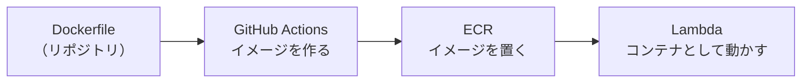

## はじめに

以下の記事にて、VercelからAWSへの移行を行ったことを説明したのですが、今回はDockerfileについての記事となります。
https://zenn.dev/nagi_dev/articles/vercel-to-aws-migration-1000yen

移行の際に書いたDockerfileについては、4段のマルチステージビルドという形になっています。
ただ、Claude Codeに頼りきりで移行したため現在後追いでどのような構成になっているのかを学習中です。

そこで、学んだことを本記事で共有します。
・Dockerfileがそれぞれどこで作られてどこで動くのか 
・レイヤーとキャッシュの仕組みと、`package.json` を先にコピーしている理由
・4段に分けたマルチステージの中身と、分けている理由

Dockerについて学習中の方にも見ていただければ幸いです。

## Dockerfile・イメージ・コンテナは、どこで作られてどこで動くのか

料理でたとえると、以下のような関係かなと思っています。

・Dockerfile はレシピ
・イメージはレシピどおりに作って冷凍した完成品（まだ動いていない状態）
・コンテナはそれを温めて食べている状態

自分のアプリ（FocusLog という時間計測アプリ）では、この3つの置き場所が分かれています。

| もの | 何か | どこにあるか |
| --- | --- | --- |
| Dockerfile | 箱の作り方を書いたレシピ | リポジトリの直下 |
| イメージ | レシピどおりに作った完成品 | GitHub Actions が作り、ECR に保存される |
| コンテナ | イメージを起動して動いている状態 | Lambda が ECR から取り出して起動する |

`main` に変更が入るたびにイメージが作り直されて、ECR に積まれていきます。Lambda 自身はビルドをしません。ECR にあるものを取り出して動かすだけです。

## なぜ package.json を先にコピーするのか

イメージの中身は、透明なシートを1枚ずつ重ねたような構造になっています。このシートがレイヤーです。

・`RUN` と `COPY` は、1行ごとに中身のあるレイヤーになる
・`ENV` `WORKDIR` `CMD` は、中身を持たない「メモ」として記録される
・その行も、それより上の行もすべて前回と同じなら、前に作ったレイヤーを使い回す（レイヤーキャッシュ）

この最後の性質があるので、Dockerfile は書く順番で速さが変わるようです。

自分の Dockerfile の1段目は、ソースコード全部（`COPY . .`）ではなく、`package.json` と lockfile だけを先にコピーしてから `pnpm install` をしています。アプリのコードを直しただけのときは `package.json` も lockfile も変わっていないので、`pnpm install` のレイヤーがそのまま使い回されます。

ここで lockfile という言葉が出てきますが、実際に入れたライブラリの版を1つ残らず書き留めた記録です。

| ファイル | `@prisma/client` の書き方 | 意味 |
| --- | --- | --- |
| `package.json` | `^6.19.3` | 6.19.3 以上・7 未満なら何でもよい |
| `pnpm-lock.yaml` | `6.19.3` | 実際に入れたのは 6.19.3 |

1段目で使っている `pnpm install --frozen-lockfile` という記述でビルドのたびに中身が変わるのを防げます。

## 4段のマルチステージ（deps / builder / tools / runner）

キッチンが4つあって、仕込みと調理は別のキッチンで済ませ、最後のキッチンには完成品だけを持ち込んで盛り付ける、という形になっています。

各段の役割と、やってみて分かった細かい事情をまとめると次のようになります。

| 段 | 何をするか | 補足 |
| --- | --- | --- |
| ① deps | 依存ライブラリを入れる | `prisma` を先に置いているのは、install の直後に `prisma generate` が自動で走るためです。これが無いと install 自体が失敗しました |
| ② builder | Next.js をビルドする | ドメインなどの値は `ARG` でビルド時に渡しています。`next.config.ts` はビルド時に評価されるので、実行時の環境変数では効きませんでした |
| ③ tools | 起動スクリプトが使う AWS SDK を用意する | ここだけ `npm` を使っています。pnpm が作るシンボリックリンクの構造が、段をまたぐ `COPY` で壊れてしまったためです |
| ④ runner | 本番用の箱を組み立てる | `/opt/extensions` に置いたものは、Lambda が起動時に拡張機能として一緒に立ち上げてくれる決まりがあるようです。`CMD` に書かなくても動きます |

分けている理由は、①②で使った pnpm・ソースコード・TypeScript・開発用のライブラリが、動かすときには要らないからです。④にはそれらを持ち込まないので、箱が小さくなり、中に余計な道具が無いぶん安全にもなるかなと思っています。

秘密の値については `.dockerignore` が効いています。`.env*` や `node_modules`、`infra`、`study` などを書いてあるので、そもそもビルドに渡りません。本番の設定値は、起動したときに SSM Parameter Store と Secrets Manager から読んでいます。

## まとめ

・Dockerfile はレシピ、イメージは冷凍した完成品、コンテナはそれを温めて動かしている状態という関係で、自分の構成では作る場所（GitHub Actions）、置く場所（ECR）、動く場所（Lambda）が分かれている
・`RUN` と `COPY` は1行ごとにレイヤーになり、上の行がすべて同じなら使い回される。だから `package.json` と lockfile を先にコピーしてから install する順番にしている
・マルチステージは4段で、最後の段には完成品だけを持ち込んでいる。

移行の作業手順書を見ながら進めたので「マルチステージにすると軽くなる」はなんとなく知っていたのですが、後から1行ずつ読み直すと、どの段が何を作って次に渡しているのかが具体的に分かりました。同じように Dockerfile を動かしているけれど中身は読んだことがない、という方は、一度上から追ってみると面白いかもしれません。

見ていただきありがとうございました！ご参考になりましたら幸いです。
