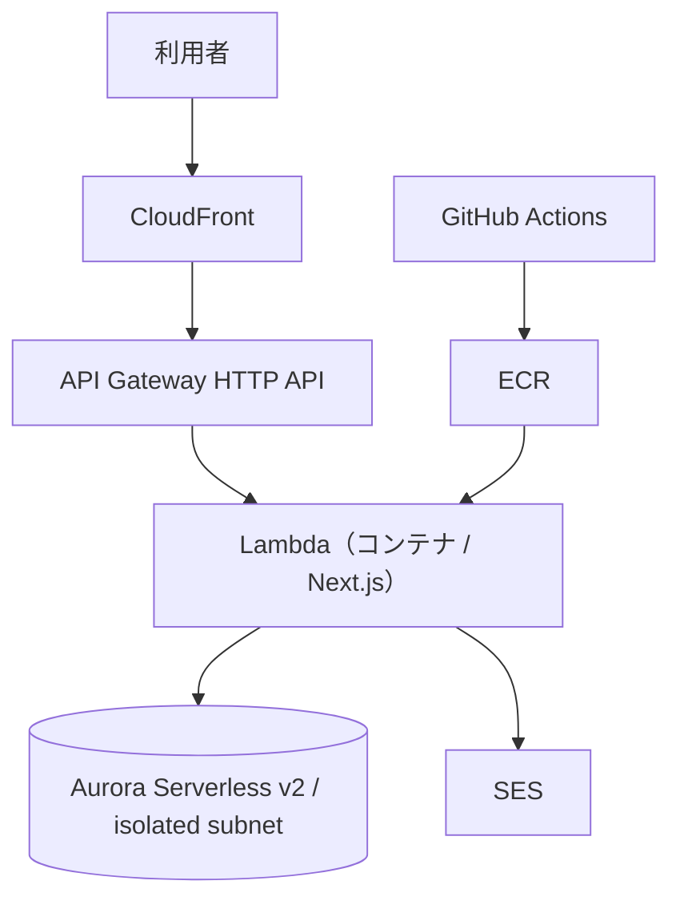

## はじめに

前に個人開発にてアプリケーションを作成したのですが、次のステップとして何を行うか考えておりました。

結果、前からAWSの構築にとても興味がありましたので、すでに動いているアプリを**Vercel から AWS へ移してみる**ことをやりました。価格なども考慮すると精神的ハードルがあったのですが、結論やってよかったです。月1,000円くらいで、実現することが出来ました。

この記事では以下を解説します。

- なぜ Vercel で十分動いていたのに AWS へ移行したのか
- 移行後の構成と、何が変わったのか
- 実際にいくらかかるのか（内訳つき）と、なぜその金額で収まるのか
- 途中で踏んだ、ドキュメントに書いていない制約

**個人開発で動くアプリは作れた／Vercel や Netlify で公開している／AWS が気になっているけれど、お金と手間が怖くて踏み出せていない**、という方に見ていただければ幸いです。

## なぜ「次の一歩」に AWS 移行なのか

移したアプリは FocusLog という自作の時間計測・タスク管理ツールで、Vercel + Neon(PostgreSQL) で**普通に動いていました**。

それでも移した理由は、**AWSにてこのツールをどのように実現できるかを体感したかった**からです。

Vercel はビルド・デプロイ・CDN・環境変数の管理・証明書の更新を**全部代わりに行ってくれます**。
ただ、同じアプリを AWS に置くと、肩代わりされていた部分を自身で実装することになります。

- ネットワークをどう区切るか（VPC・サブネット）
- 誰が何にアクセスできるか（IAM）
- ビルドしたイメージをどこに置き、どうデプロイするか（ECR・CDK・GitHub Actions）
- DB をインターネットから隔離したうえで、どうやって自分だけ接続するか

今回上記のことを自身で実装することによって資格試験で触れた技術を実際に使用することができ、勉強になりました。

## 移行後の構成



役割で分けると5つとなります。入口（CloudFront + API Gateway）、アプリ（Lambda）、DB（Aurora）、メール（SES）、置き場と配達（ECR + GitHub Actions + CDK）。

Vercelからの変化点を表にすると、以下のようになります。

| 今まで（Vercel） | 移行後（AWS） | 何が変わるか |
| --- | --- | --- |
| `git push` すると Vercel が自動でビルド・公開 | GitHub Actions が Docker イメージをビルドして ECR へ push、CDK がデプロイ | ビルド定義を自分で持つ。 |
| Vercel の環境変数画面 | SSM Parameter Store + Secrets Manager | 画面ではなく CLI / IaC で設定。値は暗号化保管 |
| Neon の管理画面で DB を見る | Aurora に SSM ポートフォワード経由で `psql` | 一手間かかる（= **インターネットから隔離できている証拠**） |
| Vercel のドメイン（`*.vercel.app`） | 独自ドメイン（Route 53 で取得） | 年間約¥2,100 の実費が発生 |
| アクセスがなくても料金ゼロ | アクセスがなくても**約¥700/月は発生** | 「完全ゼロ円」にはならない |
| 常に即座に応答 | 久しぶりの初回アクセスは **Aurora 再開15秒 + Lambda 起動2〜4秒** | デモの直前に一度温める運用が必要 |
| ローカルは `pnpm dev` | ローカルは `pnpm dev` のまま | **日々の開発体験は変わらない** |

進め方は**12フェーズに分けて、1つずつ検証してから次に進みました**。一気にやると、全体の流れが見にくくなることと、不具合が発生した際に切り分けがしにくくなるためです。

## 実際いくらかかるのか

ここがこの記事の本題です。「個人開発で AWS は高い」というイメージを持っていたのですが、**構成を選べばそうなりません**。

| サービス | 月額 |
| --- | --- |
| Lambda | ¥0（常時無料枠内） |
| CloudFront | ¥0（常時無料枠内） |
| Aurora Serverless v2 | ¥100〜600 |
| **NAT インスタンス** | **約 ¥700** |
| ECR | ¥15〜50 |
| Secrets Manager | 約 ¥60 |
| Route 53 ホストゾーン | 約 ¥75 |
| CloudWatch Logs | ¥0〜50 |
| SES | ≒ ¥0 |
| **合計** | **約 ¥950〜1,550** |
| ドメイン | 約 ¥2,100 / 年 |

この金額は私がClaude Codeを利用しての要件検討時に構成を決めた際（2026年7月）の試算です。実際の請求額は構成・リージョン・利用量で変わるので、必ず [AWS Pricing Calculator](https://calculator.aws/) でご自身の構成を確認してみてください。

### なぜこの金額で収まるのか
検討した中でコスト増加の原因が判明したので私が調査できたもののみ参考で共有します。
・NAT Gateway を使用する

調べた結果NAT Gateway はマネージドで楽のようですが、起動しているだけで月6,500円前後（東京リージョンで時間課金 0.062 USD/時 × 約730時間）かかることがわかりました。ここで大きくコスト増加してしまいます。

今回は代わりに [**fck-nat**](https://github.com/AndrewGuenther/fck-nat) **を使って、t4g.nano の NAT インスタンスを立てています**。CDK なら数行です。

```ts
const natProvider = new FckNatInstanceProvider({
  instanceType: ec2.InstanceType.of(ec2.InstanceClass.T4G, ec2.InstanceSize.NANO),
});

this.vpc = new ec2.Vpc(this, "Vpc", {
  maxAzs: 2,                       // Aurora が最低2AZを要求する
  natGatewayProvider: natProvider,
  natGateways: 1,                  // 1台のみ（コスト優先・AZ障害時は縮退）
  // ...
});
```

これで **月6,500円前後 → 約700円**になります。トレードオフは、**AZ 障害時に縮退する**ことと、**インスタンスなので自分でメンテナンスの面倒を見る**こと。個人開発なら十分に受け入れられる条件だと思います。

・無料枠が切れる2年目
　Lambda と CloudFront の「常時無料枠」は継続しますが、一部の12ヶ月無料枠は切れます。
 
・転送量が増えたとき、CloudFront の無料枠（月1TB）を超えると課金されます

・RDS / Aurora を常時起動にしたとき、Serverless v2 を最小容量まで落とさず固定インスタンスにすると、ここが一番コストが伸びるようです。

そして最初にやるべきことは、Budgets でコストアラートを設定することです。閾値を決めてメールが飛ぶようにしておけば、急なコストの怖さの大半は消えるかなと思っています。

## ハマったところ

長くなるので、ここは「結論 → なぜ起きたか → どうしたか」の3行ずつにします。
詳細については別記事で共有できたらと思っています。

### 1. CloudFront + Lambda Function URL では、本文付き POST が通らない

- **結論**: Lambda Function URL を CloudFront の OAC で保護する構成だと、**本文付きの POST / PUT が署名検証を通らず 403 になります**。Next.js の Server Actions がログイン含めてほぼ全滅しました
- **なぜ**: OAC はリクエストに署名を付けますが、**本文を含むリクエストの署名検証と噛み合わない**という AWS 仕様上の制約があります。ドキュメントに明記されておらず、実機で初めて分かりました
- **どうしたか**: 入口を **API Gateway (HTTP API) 経由に変更**しました。ただし OAC は S3 と Lambda Function URL 向けの自動設定しかなく API Gateway には使えないため、オリジン保護は「**CloudFront がカスタムヘッダーに合言葉を載せ、API Gateway 前段の Lambda Authorizer で検証する**」方式に置き換えました

> 「GET は通るのに POST だけ落ちる」ときは、認可（IAM / ポリシー）ではなく**署名の仕組みそのもの**を疑うと早いです。

### 2. Server Actions の `allowedOrigins` は、ビルド時に渡さないと効かない

- **結論**: 画面は出るのに**ボタンを押しても何も起きない**。CloudWatch に `Invalid Server Actions request` が出ていました
- **なぜ**: CloudFront 経由だと Host がオリジン側の URL になり、閲覧者の Origin（独自ドメイン）と一致しないため、Next.js の Origin 検証で弾かれます
- **どうしたか**: `next.config.ts` の `experimental.serverActions.allowedOrigins` にドメインを入れました。**ポイントは、この値が実行時の環境変数では効かず、Docker の build-arg としてビルド時に渡す必要があること**です

### 3. `docker build` のフラグを CI に引き継ぎ忘れて初回デプロイが失敗

- **結論**: ローカルでは通ったビルドが、GitHub Actions だと Lambda で動きませんでした
- **なぜ**: `docker/build-push-action` は**既定で provenance / attestation 付きの OCI イメージインデックス**を作ります。Lambda はこの形式のイメージを受け付けません
- **どうしたか**: `provenance: false` / `sbom: false` を指定しただけで解決しました。**ローカルで通った `docker build` のオプションは、CI の action でも同じになっているとは限らない**、という学びです

そして**この失敗で実害はゼロでした**。デプロイが失敗した時点で自動ロールバックされ、公開中の環境は無傷のままだったからです。IaC の安心感を一番実感したのはこの瞬間でした。**壊しても戻せる**と分かってから、手が動くようになりました。

## これから挑戦する方へ

・一気にやらず、フェーズを切って1つずつ検証すると良いかもしれません。

私は12フェーズに分けました。「VPC を作る」「DB を作る」「イメージを push する」「入口を繋ぐ」と区切って、各フェーズの終わりに動作確認を置きます。こうすると、失敗したときに**原因が直前のフェーズの中にしかない**ので、切り分けが一瞬で終わります。

・詰まった単語を書き溜めて、自分用語集を育てるようにしました

AWS は固有名詞が多く、知らない単語が出てくるたびに思考が止まります。私は詰まった用語を1行ずつメモに残して、自分用の用語集にしていきました。

学習そのものを記録に変えておくと、**同じ時間で2つの成果**（理解＋説明できる材料）が手に入ります。

## まとめ

- Vercel で動いているアプリを AWS へ移すと、肩代わりされていた部分が全部自分の手に来る。それがそのまま説明できる範囲になる
- 費用は月1,000円前後。鍵は NAT Gateway を避けて NAT インスタンスを使うこと。最初に Budgets のアラートを入れれば怖さの大半は消える
- ハマりどころはあるが、IaC なら壊しても戻せる。初回デプロイが失敗しても自動ロールバックで実害はなかった
- 進め方はフェーズを切って1つずつ検証する

見ていただきありがとうございました！ご参考になりましたら幸いです。
